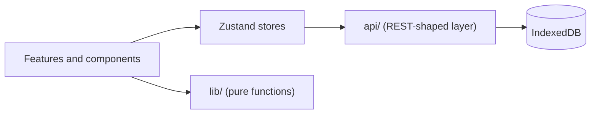

<div align="center">


# Loom

**A calm knowledge workspace that weaves structured pages into a living graph of ideas.**

Local-first · Offline-capable · Arabic (RTL) ready · Zero backend

<br />


[Features](#-features) ·
[Tech Stack](#-tech-stack) ·
[Getting Started](#-getting-started) ·
[Architecture](#-architecture) ·
[Quality](#-quality-gates) ·
[Limitations](#-known-limitations)

</div>

---

## 📖 About

Loom combines two ways of thinking in one tool: a **hierarchical page tree** for structure and a **force-directed graph** for connections. Write in a block-based editor, link ideas with `[[wikilinks]]`, and watch your notes grow into a navigable map.

Everything runs **entirely in the browser**. Your data lives in IndexedDB on your device, nothing is sent to a server, and the app keeps working offline once installed.

The data layer (`src/api/`) is written with the exact async shape of a real REST API. When a backend is needed, only that folder has to change.

## ✨ Features

### ✍️ Editor

- **18 block types:** paragraph, headings 1–3, bulleted / numbered / checklist, quote, callout, toggle, code, divider, image, file, table, Kanban board, YouTube embed, and database view
- **Rich text** with bold, italic, underline, strikethrough, inline code and four highlight colours
- **Slash menu** (`/`) to insert any block, plus Markdown shortcuts such as `**bold**`
- **Drag and drop** reordering with screen-reader announcements
- **Smart paste:** Markdown becomes real blocks, a YouTube URL becomes an embed, a copied image becomes an image block
- **Undo / redo across blocks** for add, delete, convert, move, paste and bulk actions
- **Multi-block selection** with turn-into, move, copy and delete
- **Page outline** ("On this page") with scroll tracking

### 🔗 Connections

- **Wikilinks** via `[[` or `@`, with automatic **backlinks**
- **Global graph** powered by a live d3-force simulation with draggable nodes
- **Local graph:** direct and two-step neighbours of the current page
- **Tags** and typed **page properties** (text, number, date, select, checkbox)
- **Database view:** child pages rendered as a sortable table with derived columns

### 🗂️ Organisation

- Nested page tree, **favorites**, **recents** and **daily notes**
- **Templates:** save any page as a template; 8 ready-made templates included (meeting notes, project brief, weekly planner, and more)
- **Trash** with soft-delete and restore
- **Version history:** up to 20 restorable checkpoints per page

### 🔍 Search

- **Command palette** (`⌘K` / `Ctrl+K`) with fuzzy search powered by Fuse.js
- Search filters: `in:title`, `in:content`, `in:tag`, `updated:today|week|month|7d`

### 🌍 Accessibility, i18n and design

- **Full RTL layout** and an **Arabic interface** (English fallback)
- **Light, dark and system themes**, applied before first paint to avoid flashes
- Logical CSS properties, `dir="auto"` per block, semantic HTML, visible focus states, and ARIA only where needed
- **Focus mode** (`⌘⇧F`), **print / save as PDF** with a print-safe light theme, and per-page **font, size and width**
- First-run **welcome tour** and a keyboard-shortcuts dialog

### 📦 Data and offline

- **IndexedDB persistence** with automatic migration from legacy localStorage data
- **Markdown** import and export (including `[[wikilinks]]`) and **JSON workspace backup / restore**
- **Installable PWA** with an offline-ready service worker and a user-controlled "new version available" prompt, so edits are never interrupted by an automatic reload

## 🧰 Tech Stack

| Area                 | Technology                                                                                                                                                                           |
| -------------------- | ------------------------------------------------------------------------------------------------------------------------------------------------------------------------------------ |
| ⚛️ **UI**            | [React 19](https://react.dev), [React Router 8](https://reactrouter.com)                                                                                                             |
| 🟦 **Language**      | [TypeScript 6](https://www.typescriptlang.org) in strict mode                                                                                                                        |
| ⚡ **Build**         | [Vite 8](https://vite.dev), [vite-plugin-pwa](https://vite-pwa-org.netlify.app) with Workbox                                                                                         |
| 🎨 **Styling**       | [Tailwind CSS 4](https://tailwindcss.com), [Radix UI](https://www.radix-ui.com) primitives, `class-variance-authority`, `clsx`, `tailwind-merge`, [Lucide](https://lucide.dev) icons |
| ✏️ **Editor**        | [Tiptap 3](https://tiptap.dev) (ProseMirror) with a custom highlight mark and wikilink node                                                                                          |
| 🧠 **State**         | [Zustand 5](https://zustand.docs.pmnd.rs), one store per concern                                                                                                                     |
| 🕸️ **Graph**         | [d3-force](https://d3js.org/d3-force)                                                                                                                                                |
| 🖱️ **Drag and drop** | [dnd-kit](https://dndkit.com) (core, sortable, utilities)                                                                                                                            |
| 🔎 **Search**        | [Fuse.js](https://www.fusejs.io)                                                                                                                                                     |
| 📝 **Markdown**      | [marked](https://marked.js.org) for import; a small hand-written exporter                                                                                                            |
| 🛡️ **Security**      | [DOMPurify](https://github.com/cure53/DOMPurify) for stored rich text, a sandboxed YouTube iframe                                                                                    |
| 🌐 **HTTP**          | [Axios](https://axios-http.com) client in front of the mock API                                                                                                                      |
| 💾 **Storage**       | Native IndexedDB (small custom wrapper, no extra dependency)                                                                                                                         |
| 🧪 **Testing**       | [Vitest 4](https://vitest.dev), [Testing Library](https://testing-library.com), jsdom, fake-indexeddb                                                                                |
| 🧹 **Code quality**  | [oxlint](https://oxc.rs) (React, TypeScript and jsx-a11y rules), [Prettier](https://prettier.io) with the Tailwind plugin                                                            |

## 🚀 Getting Started

**Prerequisites:** Node.js 22 LTS or newer, and npm.

```bash
git clone <your-repo-url> loom
cd loom
npm ci
npm run dev
```

Open the URL printed by Vite (usually `http://localhost:5173`).

### Scripts

| Command                           | Description                                           |
| --------------------------------- | ----------------------------------------------------- |
| `npm run dev`                     | Start the Vite dev server                             |
| `npm run build`                   | Type-check, then create a production build in `dist/` |
| `npm run preview`                 | Serve the production build locally                    |
| `npm run typecheck`               | `tsc -b --noEmit`                                     |
| `npm run lint`                    | Run oxlint                                            |
| `npm test`                        | Run the Vitest suite once                             |
| `npm run test:watch`              | Vitest in watch mode                                  |
| `npm run format` / `format:check` | Write / check Prettier formatting                     |

### Deploying

Loom is a static single-page app. Deploy the contents of `dist/` to any static host and make sure:

- Every route falls back to `index.html` (client-side routing).
- The site is served over **HTTPS**, which the service worker and install prompt require.
- `sw.js` and `index.html` are served with `Cache-Control: no-cache`; hashed files under `/assets/` can be cached as immutable.

## 🏗️ Architecture



Key rules the codebase follows:

- **`src/api/` is the only layer that touches persistence.** Functions are async and shaped like real REST calls, so a future backend only replaces this folder.
- **Derived data is never stored twice.** The page tree, backlinks and graph layout are computed from flat state.
- **`src/lib/` is pure functions only.** No React and no store access, which keeps the logic easy to test first.
- **Feature-first structure.** Each `src/features/<name>/` owns its components and a README describing what is real and what is a placeholder.
- **State is split by who needs it.** Local UI state stays in `useState`; shared state lives in focused Zustand stores.

### Project structure

```text
src/
├── api/          # REST-shaped data layer over IndexedDB
├── components/   # Shared UI (button, dialog, toast, ...)
├── features/     # editor, graph, search, pages, workspace, templates, ...
├── hooks/        # Reusable React hooks
├── i18n/         # English and Arabic dictionaries
├── layouts/      # App shell, sidebar, top bar
├── lib/          # Pure, framework-free helpers
├── routes/       # Route-level screens
├── stores/       # Zustand stores
├── test/         # Test setup and shared fixtures
└── types/        # Shared entity types
```

## ✅ Quality Gates

Every change must pass four gates, in order:

| #   | Gate       | Command             | Requirement             |
| --- | ---------- | ------------------- | ----------------------- |
| 1   | Type check | `npm run typecheck` | 0 errors                |
| 2   | Lint       | `npm run lint`      | 0 errors, 0 warnings    |
| 3   | Tests      | `npm test`          | all passing (480 tests) |
| 4   | Build      | `npm run build`     | completes cleanly       |

Tests are co-located with the code they cover and use shared fixtures from `src/test/fixtures.ts`.

## 🔐 Security Notes

- Stored rich text is **sanitized with DOMPurify** before being rendered as HTML, and HTML is parsed through an inert `DOMParser` rather than `innerHTML`.
- The YouTube embed uses `youtube-nocookie.com` inside a **restricted iframe sandbox**.
- All data stays on the user's device. No credentials, tokens or secrets exist in the project.

## ⌨️ Keyboard Shortcuts

| Shortcut                   | Action                      |
| -------------------------- | --------------------------- |
| `⌘/Ctrl` + `K`             | Command palette             |
| `⌘/Ctrl` + `N`             | New page                    |
| `⌘/Ctrl` + `⇧` + `F`       | Toggle focus mode           |
| `/`                        | Insert a block              |
| `[[` or `@`                | Link to a page              |
| `⌘/Ctrl` + `B` / `I` / `U` | Bold / italic / underline   |
| `⌘/Ctrl` + `E`             | Inline code                 |
| `⌘/Ctrl` + `Z` / `⇧` + `Z` | Undo / redo                 |
| `Esc` (inside a block)     | Start multi-block selection |

## ⚠️ Known Limitations

- **Client-only:** there is no sync between devices. Use JSON backup and restore to move data.
- **Page style** (font, size, width) is stored per device and is not included in exports.
- **Arabic interface** covers the main UI; some editor labels and secondary screens are still English. The Arabic copy has not had a native-editor review.
- **No dedicated Arabic web font** yet; the system font is used.
- **Backup import** validates structure only, not a full schema.
- Print, service worker and install flows depend on browser behaviour and should be checked in a real browser after each release.

## 🗺️ Roadmap

- [ ] Full schema validation for backup import
- [ ] Route-level code splitting to reduce the initial bundle
- [ ] Self-hosted Arabic web font
- [ ] Complete Arabic translation of remaining screens
- [ ] Optional real backend behind the existing `src/api/` layer

## 🤝 Contributing

1. Read `CLAUDE.md` and `.claude/rules/` for the conventions.
2. Put new UI inside the feature it belongs to, and write pure logic in `src/lib/` first.
3. Use named exports, the `@/` import alias and strict TypeScript, and avoid `any`.
4. Run all four quality gates before opening a pull request.

## 📄 License

No license file is included yet. Add one (for example MIT) before publishing the repository.

---

<div align="center">

Built with care using React, TypeScript and Tiptap.

</div>
