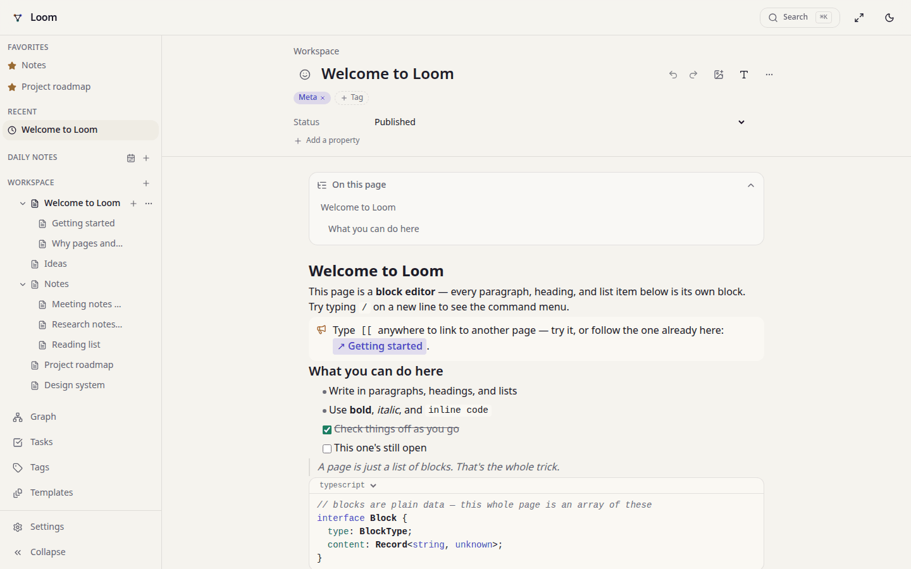
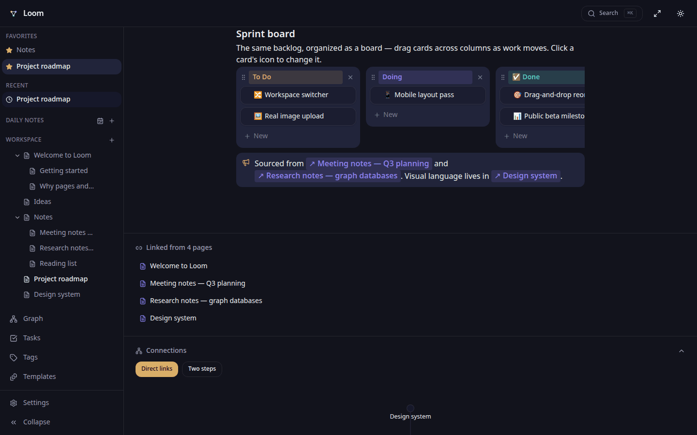
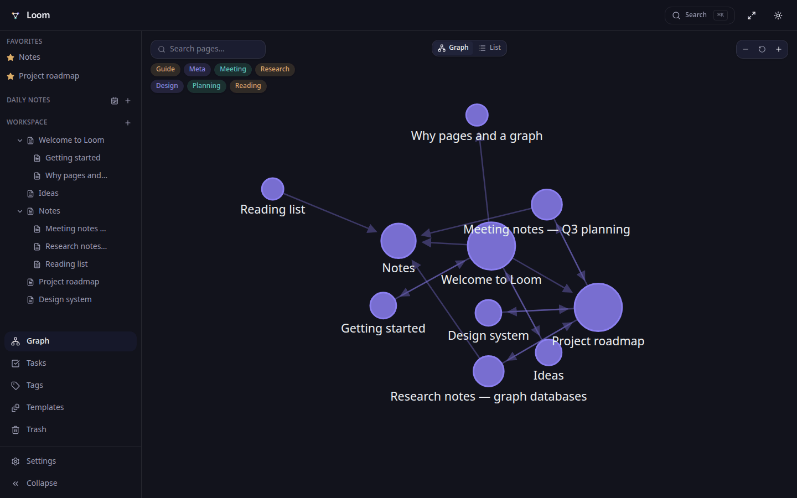
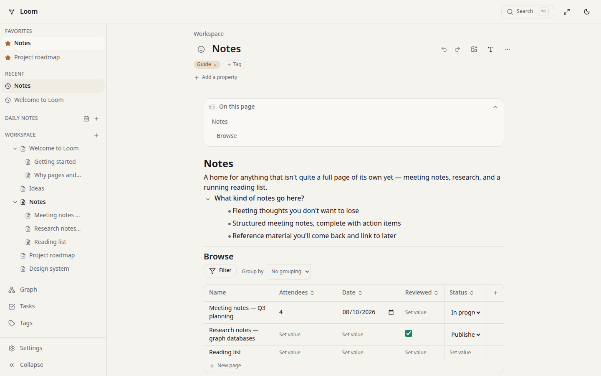
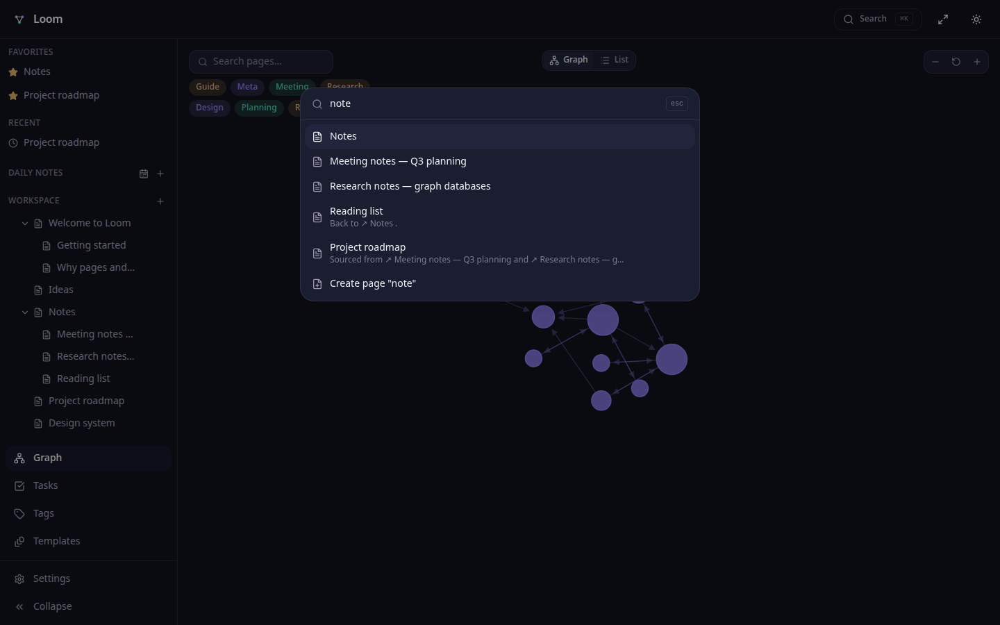
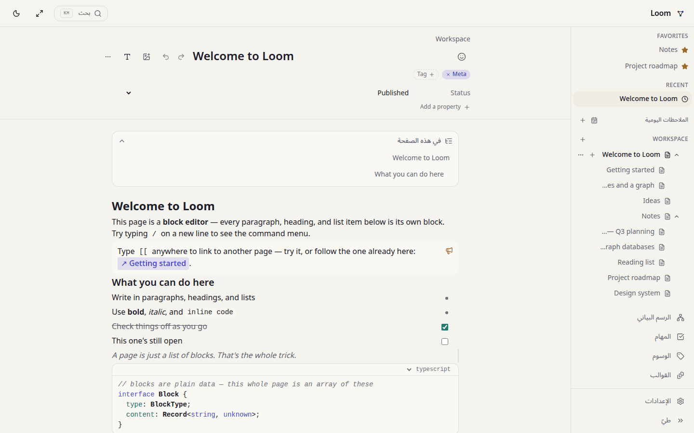
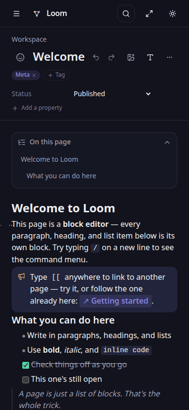
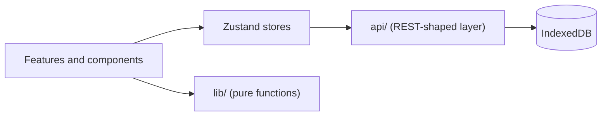

<div align="center">


# Loom

**A calm knowledge workspace that weaves structured pages into a living graph of ideas.**

Local-first · Offline-capable · Arabic (RTL) ready · Zero backend

<br />

[](https://react.dev)
[](https://www.typescriptlang.org)
[](https://vite.dev)
[](https://tailwindcss.com)
[](https://reactrouter.com)
[](https://tiptap.dev)
[](https://zustand.docs.pmnd.rs)
[](https://d3js.org/d3-force)
[](https://vite-pwa-org.netlify.app)

[](https://vitest.dev)
[](https://playwright.dev)
[](https://oxc.rs)
[](https://prettier.io)
[](https://nodejs.org)

<br />

[Screenshots](#-screenshots) ·
[Features](#-features) ·
[Tech Stack](#-tech-stack) ·
[Getting Started](#-getting-started) ·
[Architecture](#-architecture) ·
[Quality](#-quality-gates) ·
[Deployment](#-deployment) ·
[Troubleshooting](#-troubleshooting) ·
[Limitations](#-known-limitations)

</div>

---

## 📖 About

Loom combines two ways of thinking in one tool: a **hierarchical page tree** for structure and a **force-directed graph** for connections. Write in a block-based editor, link ideas with `[[wikilinks]]`, and watch your notes grow into a navigable map.

Everything runs **entirely in the browser**. Your data lives in IndexedDB on your device, nothing is sent to a server, and the app keeps working offline once installed.

The data layer (`src/api/`) is written with the exact async shape of a real REST API. When a backend is needed, only that folder has to change.

## 🖼️ Screenshots

All images are real captures of the running app (demo workspace, 1440×900 desktop and 390×844 mobile).

<table>
  <tr>
    <td width="50%"><br /><sub><b>Block editor</b> — light theme, outline, tags and properties</sub></td>
    <td width="50%"><br /><sub><b>Kanban board and backlinks</b> — dark theme</sub></td>
  </tr>
  <tr>
    <td width="50%"><br /><sub><b>Knowledge graph</b> — live d3-force layout with draggable nodes</sub></td>
    <td width="50%"><br /><sub><b>Database view</b> — sortable, filterable, groupable</sub></td>
  </tr>
  <tr>
    <td width="50%"><br /><sub><b>Command palette</b> — fuzzy search with <code>Ctrl/⌘ + K</code></sub></td>
    <td width="50%"><br /><sub><b>Arabic (RTL)</b> — fully mirrored layout</sub></td>
  </tr>
</table>

<p align="center">
  <br />
  <sub><b>Responsive</b> — works on small screens</sub>
</p>

## ✨ Features

### ✍️ Editor

- **19 block types:** paragraph, headings 1–3, bulleted / numbered / checklist, quote, callout, toggle, code, divider, image, file, table, Kanban board, YouTube embed, database view, and **math equations** (KaTeX, loaded on demand)
- **Syntax-highlighted code blocks** for JavaScript, TypeScript, JSON, HTML, CSS, Python, Bash, SQL and Markdown; languages load only when used
- **Images** open in an accessible full-size dialog
- **Rich text** with bold, italic, underline, strikethrough, inline code and four highlight colours
- **Slash menu** (`/`) to insert any block, plus Markdown shortcuts such as `**bold**`
- **Drag and drop** reordering with screen-reader announcements
- **Smart paste:** Markdown becomes real blocks, a YouTube URL becomes an embed, a copied image becomes an image block
- **Undo / redo across blocks** for add, delete, convert, move, paste and bulk actions
- **Multi-block selection** with turn-into, move, copy and delete
- **Page outline** ("On this page") with scroll tracking

### 🔗 Connections

- **Wikilinks** via `[[` or `@`, with automatic **backlinks**
- **Global graph** powered by a live d3-force simulation with draggable nodes
- **Local graph:** direct and two-step neighbours of the current page
- **Tags** and typed **page properties** (text, number, date, select, checkbox)
- **Database view:** child pages as a table with derived columns, **sorting, filters** (AND, typed operators) and **group by** any column

### 🗂️ Organisation

- Nested page tree, **favorites**, **recents** and **daily notes** with a month **calendar** (days with a note are marked)
- **Tasks hub:** every checklist item from every page in one place, filterable by open / done
- **Page covers** (six built-in gradients) next to page icons
- **Templates:** save any page as a template; 8 ready-made templates included (meeting notes, project brief, weekly planner, and more)
- **Trash** screen with soft-delete, restore and permanent delete
- **Version history:** up to 20 restorable checkpoints per page

### 🔍 Search

- **Command palette** (`⌘K` / `Ctrl+K`) with fuzzy search powered by Fuse.js
- Search filters: `in:title`, `in:content`, `in:tag`, `updated:today|week|month|7d`

### 🌍 Accessibility, i18n and design

- **Full RTL layout** and an **Arabic interface** (English fallback) with a bundled Arabic web font (Noto Sans Arabic)
- **Light, dark and system themes**, applied before first paint to avoid flashes, plus four **accent colors**
- Logical CSS properties, `dir="auto"` per block, semantic HTML, visible focus states, and ARIA only where needed
- **Focus mode** (`⌘⇧F`), **print / save as PDF** with a print-safe light theme, and per-page **font, size and width**
- First-run **welcome tour** and a keyboard-shortcuts dialog

### 📦 Data and offline

- **IndexedDB persistence** with automatic migration from legacy localStorage data
- **Export a page** as Markdown or a standalone HTML file; **export every page** as one Markdown ZIP
- **Import Markdown files** as pages; `[[wikilinks]]` between files are linked, and missing targets get placeholder pages
- **JSON workspace backup / restore**, validated against a schema before anything is replaced
- **Status panel** in Settings: online state, storage used, and a reminder when the last backup is old
- **Installable PWA** with an offline-ready service worker and a user-controlled "new version available" prompt, so edits are never interrupted by an automatic reload

## 🧰 Tech Stack

| Area                     | Technologies                                                                                                                                                                                                                                                                                                                                                                                                                                                                                                               |
| ------------------------ | -------------------------------------------------------------------------------------------------------------------------------------------------------------------------------------------------------------------------------------------------------------------------------------------------------------------------------------------------------------------------------------------------------------------------------------------------------------------------------------------------------------------------- |
| **UI and routing**       | [](https://react.dev) [](https://reactrouter.com)                                                                                                                                                                                                                                               |
| **Language**             | [](https://www.typescriptlang.org)                                                                                                                                                                                                                                                                                                                                                                       |
| **Build and PWA**        | [](https://vite.dev) [](https://vite-pwa-org.netlify.app)                                                                                                                                                                                                                                   |
| **Styling**              | [](https://tailwindcss.com) [](https://www.radix-ui.com) [](https://lucide.dev)                                                                                                    |
| **Editor**               | [](https://tiptap.dev) [](https://prosemirror.net)                                                                                                                                                                                                                                                                              |
| **State**                | [](https://zustand.docs.pmnd.rs)                                                                                                                                                                                                                                                                                                                                                                                                                |
| **Graph**                | [](https://d3js.org/d3-force)                                                                                                                                                                                                                                                                                                                                                                                         |
| **Drag and drop**        | [](https://dndkit.com)                                                                                                                                                                                                                                                                                                                                                                                                                           |
| **Search**               | [](https://www.fusejs.io)                                                                                                                                                                                                                                                                                                                                                                                                                         |
| **Markdown, math, code** | [](https://marked.js.org) [](https://katex.org) [](https://highlightjs.org) [](https://github.com/101arrowz/fflate)                                                                    |
| **Validation, security** | [](https://zod.dev) [](https://github.com/cure53/DOMPurify)                                                                                                                                                                                                                                                                                        |
| **Data**                 | [](https://developer.mozilla.org/docs/Web/API/IndexedDB_API) [](https://axios-http.com)                                                                                                                                                                                                                                                      |
| **Testing**              | [](https://vitest.dev) [](https://testing-library.com) [](https://playwright.dev) [](https://github.com/dequelabs/axe-core) |
| **Code quality**         | [](https://oxc.rs) [](https://prettier.io)                                                                                                                                                                                                                                                     |

Other dependencies: `class-variance-authority`, `clsx`, `tailwind-merge`, [Fontsource](https://fontsource.org) Noto Sans Arabic (variable), jsdom and fake-indexeddb for tests. The YouTube embed uses a sandboxed iframe.

## 🚀 Getting Started

**Prerequisites:** Node.js 22.22.2 or newer (Node 24 LTS recommended; `.nvmrc` selects it for fnm and nvm), and npm.

```bash
git clone <your-repo-url> loom
cd loom
npm ci
npm run dev
```

Open the URL printed by Vite (usually `http://localhost:5173`).

### Scripts

| Command                           | Description                                                            |
| --------------------------------- | ---------------------------------------------------------------------- |
| `npm run dev`                     | Start the Vite dev server                                              |
| `npm run build`                   | Type-check, then create a production build in `dist/`                  |
| `npm run preview`                 | Serve the production build locally                                     |
| `npm run typecheck`               | `tsc -b --noEmit` (app and Node configs)                               |
| `npm run lint`                    | Run oxlint                                                             |
| `npm test` / `npm run test`       | Run the Vitest suite once (both names run the same script)             |
| `npm run test:e2e`                | Build, serve the production build and run the Playwright browser tests |
| `npm run test:watch`              | Vitest in watch mode                                                   |
| `npm run format` / `format:check` | Write / check Prettier formatting                                      |

## 🏗️ Architecture



Key rules the codebase follows:

- **`src/api/` is the only layer that touches persistence.** Functions are async and shaped like real REST calls, so a future backend only replaces this folder.
- **Derived data is never stored twice.** The page tree, backlinks and graph layout are computed from flat state.
- **`src/lib/` is pure functions only.** No React and no store access, which keeps the logic easy to test first.
- **Feature-first structure.** Each `src/features/<name>/` owns its components and a README describing what is real and what is a placeholder.
- **State is split by who needs it.** Local UI state stays in `useState`; shared state lives in focused Zustand stores.

### Project structure

```text
src/
├── api/          # REST-shaped data layer over IndexedDB
├── components/   # Shared UI (button, dialog, toast, ...)
├── features/     # editor, graph, search, pages, workspace, templates, ...
├── hooks/        # Reusable React hooks
├── i18n/         # English and Arabic dictionaries
├── layouts/      # App shell, sidebar, top bar
├── lib/          # Pure, framework-free helpers
├── routes/       # Route-level screens
├── stores/       # Zustand stores
├── test/         # Test setup and shared fixtures
└── types/        # Shared entity types
e2e/              # Playwright browser tests (run against the production build)
docs/             # Changelog, documentation index, screenshots
public/           # Static assets, PWA icons, host configuration (_headers, _redirects)
```

## ✅ Quality Gates

Every change must pass four gates, in order:

| #   | Gate       | Command             | Requirement             |
| --- | ---------- | ------------------- | ----------------------- |
| 1   | Type check | `npm run typecheck` | 0 errors                |
| 2   | Lint       | `npm run lint`      | 0 errors, 0 warnings    |
| 3   | Tests      | `npm test`          | all passing (565 tests) |
| 4   | Build      | `npm run build`     | completes cleanly       |

Run these as well before a release:

| Check            | Command                                 | Requirement                    |
| ---------------- | --------------------------------------- | ------------------------------ |
| End-to-end tests | `npm run test:e2e`                      | all passing (17 flows)         |
| Formatting       | `npm run format:check`                  | no files reported              |
| Dependencies     | `npm audit`                             | 0 vulnerabilities              |
| E2E type check   | `npx tsc -p e2e/tsconfig.json --noEmit` | 0 errors (not part of the app) |

> **Use `npm run typecheck`, not `npx tsc --noEmit`.** The root `tsconfig.json` is a solution file (`"files": []` plus project references), so a bare `npx tsc --noEmit` checks no source files and always succeeds. `npm run typecheck` runs `tsc -b --noEmit` and checks the app (`tsconfig.app.json`) and the Vite config (`tsconfig.node.json`).

Unit tests are co-located with the code they cover (70 files) and use shared fixtures from `src/test/fixtures.ts`. Key components are also checked with axe (`src/test/a11y.test.tsx`). `npm run test:e2e` drives the production build in Chromium (17 flows, including the offline service worker, RTL, exports and imports).

## 🌐 Deployment

Loom is a static single-page app: `npm run build` produces everything in `dist/`, and no server or environment variables are needed.

- **Host it at a domain root.** The build uses absolute `/assets/...` paths.
- **Serve over HTTPS.** Service workers (offline support) do not run on plain HTTP, except on `localhost`.
- **Rewrite unknown paths to `/index.html`.** The app uses client-side routing, so a refresh on `/w/default/graph` would otherwise return a 404.
- **Never cache `sw.js` and `manifest.webmanifest`** (`Cache-Control: no-cache`), or users keep an old version after an update. Hashed files under `/assets/` can be cached as immutable.

Ready-made configuration is included:

| Host                      | File                                                                           |
| ------------------------- | ------------------------------------------------------------------------------ |
| Netlify, Cloudflare Pages | [`public/_redirects`](public/_redirects), [`public/_headers`](public/_headers) |
| Vercel                    | [`vercel.json`](vercel.json)                                                   |

For nginx, the equivalent is:

```nginx
location / { try_files $uri /index.html; }
location = /sw.js { add_header Cache-Control "no-cache"; }
location = /manifest.webmanifest { add_header Cache-Control "no-cache"; }
```

Check a production build locally with `npm run build && npm run preview`.

## 🔐 Security Notes

- Stored rich text is **sanitized with DOMPurify** before being rendered as HTML, and HTML is parsed through an inert `DOMParser` rather than `innerHTML`.
- Backup files are validated with a Zod schema; Markdown and HTML exports sanitize page content, and KaTeX runs with `trust: false`.
- The YouTube embed uses `youtube-nocookie.com` inside a **restricted iframe sandbox**.
- All data stays on the user's device. No credentials, tokens or secrets exist in the project, and no `.env` file is needed.
- `npm audit` reports 0 known vulnerabilities for the committed lockfile.

## 🩺 Troubleshooting

| Symptom                                                               | Cause and fix                                                                                                                       |
| --------------------------------------------------------------------- | ----------------------------------------------------------------------------------------------------------------------------------- |
| `npm warn EBADENGINE` for `jsdom` and related packages                | Your Node.js is older than 22.22.2. The test environment (jsdom 30) requires Node `^22.22.2 \|\| ^24.15.0 \|\| >=26`. Upgrade Node. |
| `npx tsc --noEmit` passes but never reports errors                    | It checks no files (see [Quality Gates](#-quality-gates)). Use `npm run typecheck`.                                                 |
| `npm run test:e2e`: browser executable not found                      | Run `npx playwright install chromium`, or point `PLAYWRIGHT_CHROMIUM_PATH` at an installed Chromium.                                |
| `npm run test:e2e`: Chromium fails to start in a container or as root | Set `CI=1` so the config adds `--no-sandbox` (this also enables one retry and the GitHub reporter).                                 |
| E2E tests run against an outdated build                               | A preview server is already listening on port 4173 and is reused when `CI` is unset. Stop it, then run the tests again.             |
| `npm install <package>` crashes with `reading 'edgesOut'` on npm 10   | Known npm resolver bug (see [`docs/CHANGELOG.md`](docs/CHANGELOG.md)). Install the existing dependencies with `npm ci`.             |
| Users keep seeing an old version after a deployment                   | `sw.js` or `manifest.webmanifest` is being cached. Serve both with `Cache-Control: no-cache` (see [Deployment](#-deployment)).      |
| A page refresh returns 404 on a deep link                             | The host does not rewrite unknown paths to `/index.html` (see [Deployment](#-deployment)).                                          |

### `npm test` ends with `Worker exited unexpectedly`

If `npm test` prints dozens of `Worker forks emitted error` / `Worker exited unexpectedly` entries and `Test Files  no tests`, the Vitest worker process is dying while it starts, before any test code runs. This was reported on Windows with Node.js 26.x. The suite itself passes on Linux with Node 22.22.3, 24.21.0 and 26.11.1 (70 files, 565 tests), so the cause on Windows is not confirmed.

1. Run on an LTS release first: install Node 24 (nodejs.org, nvm-windows, fnm or Volta; fnm and nvm read `.nvmrc`), then run `npm ci` and `npm test` again.
2. If it still fails, find the layer that crashes:
   - `node --input-type=module -e "import { JSDOM } from 'jsdom'; new JSDOM('<p>ok</p>'); console.log('jsdom ok')"` runs jsdom alone, without Vitest.
   - `npx vitest run src/lib/url.test.ts --environment node` runs Vitest without jsdom.
   - `npx vitest run src/lib/url.test.ts --pool=threads` uses worker threads instead of child processes.
3. Look above the `Unhandled Error` blocks in the log: anything the crashing worker printed appears there, and it is the most useful detail to include in a bug report.

## ⌨️ Keyboard Shortcuts

| Shortcut                   | Action                      |
| -------------------------- | --------------------------- |
| `⌘/Ctrl` + `K`             | Command palette             |
| `⌘/Ctrl` + `N`             | New page                    |
| `⌘/Ctrl` + `⇧` + `F`       | Toggle focus mode           |
| `/`                        | Insert a block              |
| `[[` or `@`                | Link to a page              |
| `⌘/Ctrl` + `B` / `I` / `U` | Bold / italic / underline   |
| `⌘/Ctrl` + `E`             | Inline code                 |
| `⌘/Ctrl` + `Z` / `⇧` + `Z` | Undo / redo                 |
| `Esc` (inside a block)     | Start multi-block selection |

## ⚠️ Known Limitations

- **Client-only:** there is no sync between devices. Use JSON backup and restore to move data.
- **Page style** (font, size, width) is stored per device and is not included in exports.
- **Arabic interface** covers the main UI; some editor labels and secondary screens are still English. The Arabic copy has not had a native-editor review.
- **Markdown import** creates flat, top-level pages (no folders) and does not read `$$` equations back; more than 50 files, or files over 1 MB, are rejected.
- **Color contrast** is not covered by the automated axe checks (jsdom has no styles); review it in a browser after design changes.
- **Browser coverage:** the end-to-end suite runs in Chromium only. Safari, Firefox and real phones are not covered by automated tests.
- **Bundle size:** the lazy-loaded editor chunk (Tiptap and ProseMirror) is about 511 kB and triggers Vite's 500 kB warning during `npm run build`. It is only downloaded when a page is opened.
- Print, service worker and install flows depend on browser behaviour and should be checked in a real browser after each release.

## 🗺️ Roadmap

- [x] Schema validation for backup import
- [x] Route-level code splitting and vendor chunks
- [x] Bundled Arabic web font
- [ ] Split the editor chunk further (Tiptap)
- [ ] Mermaid diagrams, tabs and split view
- [ ] Complete Arabic translation of remaining screens
- [ ] Optional real backend behind the existing `src/api/` layer

## 📚 Documentation

| Document                                 | What it covers                                                          |
| ---------------------------------------- | ----------------------------------------------------------------------- |
| [`docs/README.md`](docs/README.md)       | Documentation index and writing conventions                             |
| [`docs/skills.md`](docs/skills.md)       | Skills the project needs, plus the Claude Code skills, agents and hooks |
| [`docs/CHANGELOG.md`](docs/CHANGELOG.md) | Release notes and known limitations                                     |
| [`CLAUDE.md`](CLAUDE.md)                 | Rules and commands for working on the code                              |

## 🤝 Contributing

1. Read `CLAUDE.md` and `.claude/rules/` for the conventions, and see [`docs/skills.md`](docs/skills.md) for the skills involved.
2. Put new UI inside the feature it belongs to, and write pure logic in `src/lib/` first.
3. Use named exports, the `@/` import alias and strict TypeScript, and avoid `any`.
4. Run all four quality gates before opening a pull request.

## 📄 License

No license file is included yet. Add one (for example MIT) before publishing the repository.

---

<div align="center">

Built with care using React, TypeScript and Tiptap.

</div>
